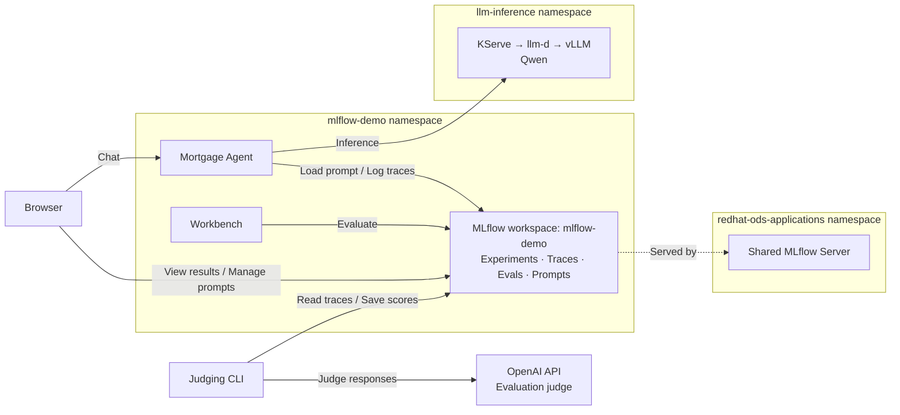

# Demo architecture

The workspace is scoped to the project, while the MLflow service is shared.
The workspace box represents logical ownership, not physical storage in the
namespace. The shared MLflow server uses PostgreSQL and MinIO for persistence;
those storage services are omitted from this slide.

The agent loads its prompt from the workspace's MLflow Prompt Registry using
`mortgage-lending-agent@production`. Moving the alias selects the prompt version
used by the deployed agent after its short cache expires.
