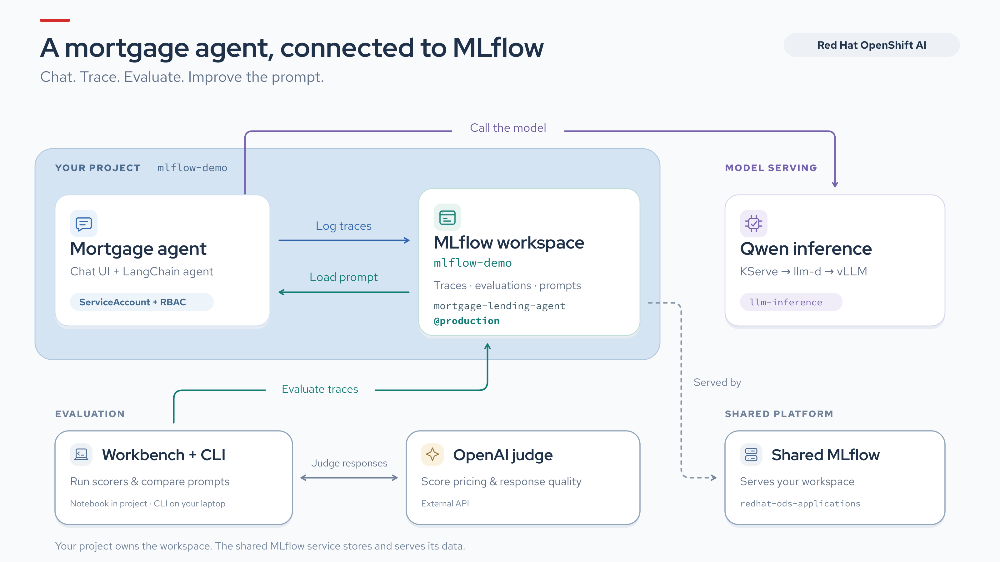

# Demo architecture

[Download slide image — PNG, 3200 × 1800](demo-architecture.png) ·
[Editable vector — SVG](demo-architecture.svg)

The slide emphasizes three connections: the agent calls Qwen, logs traces to its
MLflow workspace, and loads its production prompt from that workspace. A workbench
or local CLI evaluates traces with an external OpenAI judge.

The workspace represents logical ownership by project `mlflow-demo`, not physical
storage in that namespace. The shared MLflow service runs in
`redhat-ods-applications` and uses PostgreSQL and MinIO for persistence; those
storage services are omitted from the slide. The workbench runs in `mlflow-demo`;
the CLI runs on the user's laptop. The browser provides chat access and MLflow's
UI for inspecting results and managing prompts.

The agent loads `mortgage-lending-agent@production` from the workspace's Prompt
Registry. Moving the alias selects the prompt version used by the deployed agent
after its short cache expires. ServiceAccount identity and RBAC govern the agent's
access to MLflow and Qwen.
