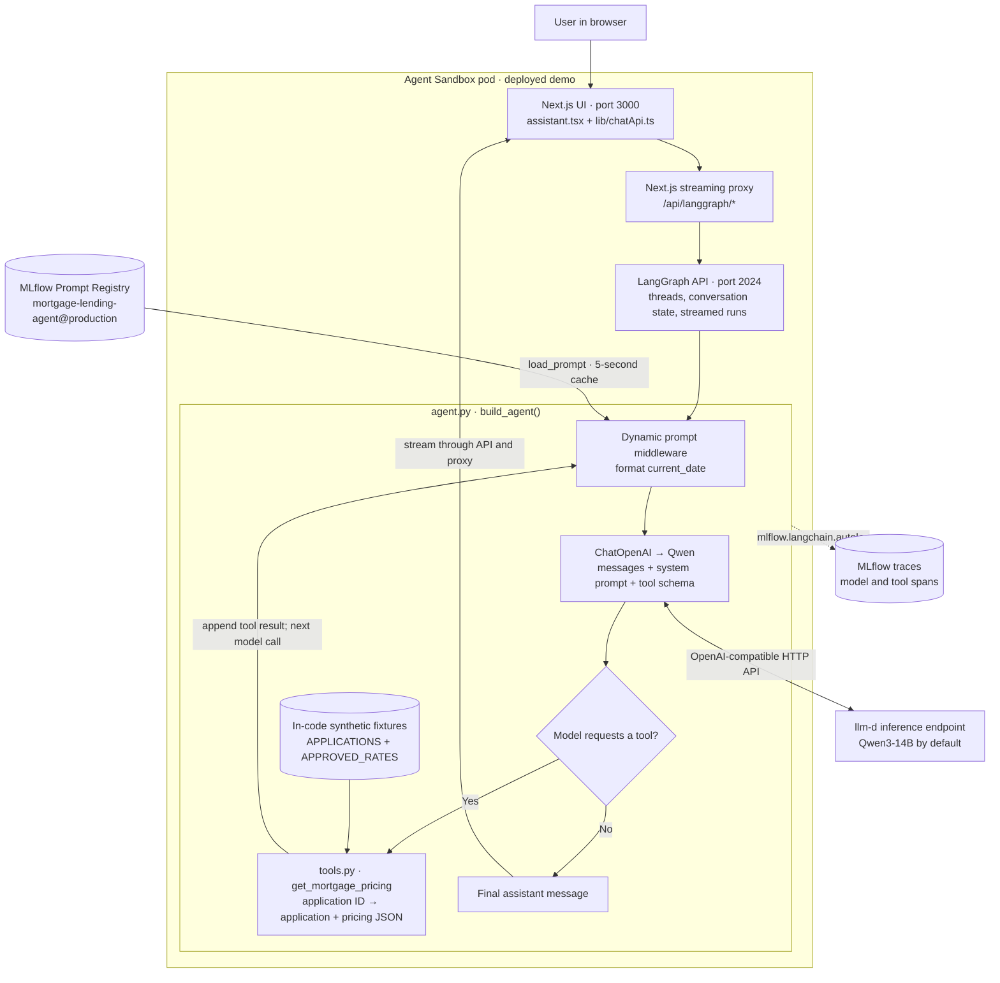
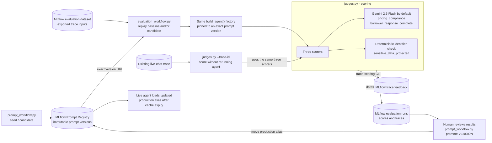

# Mortgage agent architecture

The agent is a LangGraph conversation loop built by LangChain's `create_agent()`.
Qwen decides whether to call the mortgage-pricing tool or return an answer. MLflow
provides the system prompt and records traces; separate evaluation commands score
the results and help choose which prompt version to promote.

## Live chat

1. The UI creates or loads a thread and streams a run for assistant ID `agent`.
   `langgraph.json` maps that ID to `agent.py:build_default_agent()`.
2. `build_default_agent()` calls the cached `build_agent()` factory. It wires up
   the model, prompt middleware, one tool, and MLflow tracing.
3. Before each model call, middleware loads the selected prompt and inserts today's
   date. The live agent uses the `production` alias, with a five-second prompt cache.
4. If Qwen requests `get_mortgage_pricing`, LangGraph executes the Python function,
   adds its result to the conversation, and calls the model again. Otherwise the
   model's answer completes the run.

The tool reads local synthetic dictionaries, so there is no mortgage database or
external pricing service in this demo. For `M-2048`, it returns Matt Hicks's
application and an illustrative **6.25%** rate that is **not locked or guaranteed**.
Tool use and SSN redaction are instructed by the prompt; this graph does not
hard-code a mandatory pricing lookup or an output-redaction step.

## Evaluation and prompt improvement

Dataset evaluation reruns the agent with a pinned prompt version and records an
evaluation run. The trace-scoring CLI instead scores an existing trace and saves
feedback on it. The judge models are used during scoring, outside the live chat
path. Promotion is an explicit command; it changes the prompt alias without
rebuilding the application or changing the agent model.

## Code map

Paths below are relative to the repository root.

| File | Responsibility |
| --- | --- |
| [`agent.py`](../mlflow_notes_agent/agent.py) | Assemble the agent, model client, dynamic prompt, tools, and tracing. |
| [`tools.py`](../mlflow_notes_agent/tools.py) | Define the pricing tool, input schema, and synthetic fixtures. |
| [`config.py`](../mlflow_notes_agent/config.py) | Read and cache environment settings, including model endpoints. |
| [`inference_auth.py`](../mlflow_notes_agent/inference_auth.py) | Read the projected service-account token for each inference HTTP request when configured; otherwise the model client uses `LLM_API_KEY`. |
| [`langgraph.json`](../langgraph.json) | Register the graph factory and additional FastAPI app. |
| [`webapp.py`](../mlflow_notes_agent/webapp.py) | Add `/healthz`; LangGraph supplies the thread and run APIs. |
| [`ui/app/assistant.tsx`](../ui/app/assistant.tsx) | Connect assistant-ui to LangGraph threads and streaming. |
| [`ui/lib/chatApi.ts`](../ui/lib/chatApi.ts) | Create threads, load state, and stream runs with the LangGraph SDK. |
| [`ui/app/api/langgraph/[[...path]]/route.ts`](../ui/app/api/langgraph/%5B%5B...path%5D%5D/route.ts) | Proxy browser API requests and streamed responses to the backend. |
| [`prompt_workflow.py`](../mlflow_notes_agent/prompt_workflow.py) | Register prompts and move the `production` alias. |
| [`evaluation_workflow.py`](../mlflow_notes_agent/evaluation_workflow.py) | Replay a dataset with exact prompt versions. |
| [`judges.py`](../mlflow_notes_agent/judges.py) | Define scorers and attach feedback to recorded traces. |
| [`__main__.py`](../mlflow_notes_agent/__main__.py) | Alternative terminal chat that invokes the same agent directly. |

The deployed UI and backend run as two containers in one Sandbox pod. The backend
uses the demo's in-memory LangGraph development server; conversation state is not
a durable application database. Open this document in a Mermaid-capable Markdown
preview to view the diagrams.
