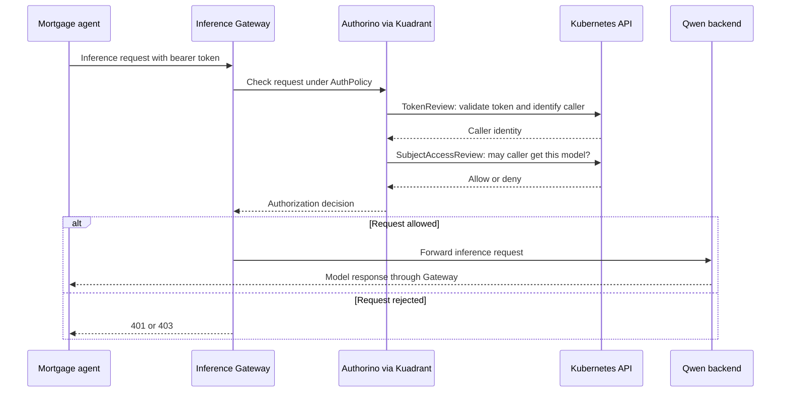

# RHOAI inference authentication: RHCL, KServe, and ServiceAccounts

These notes describe the Qwen deployment used by this demo on unreleased RHOAI
3.6. They describe the verified configuration, rather than a guarantee for every
RHOAI or KServe installation.

## Who provides what?

| Component | Responsibility in this deployment |
| --- | --- |
| RHOAI KServe/LLM inference integration | Deploys and manages the model-serving integration. RHOAI's `odh-model-controller` creates the Gateway authentication policy. |
| Inference Gateway | Receives external inference traffic and forwards allowed requests to the model-serving backend. |
| RHCL (Red Hat Connectivity Link) | Provides the supported product integration built around Kuadrant and its supporting components. |
| Kuadrant | Reconciles `AuthPolicy` resources and configures enforcement at the Gateway. |
| Authorino | Performs the authentication and authorization checks defined by the policy, consulting Kubernetes. |
| Kubernetes ServiceAccount and RBAC | Supply the caller's identity and determine whether it has permission to access the requested model. |
| Qwen inference server | Handles model requests after the Gateway allows them; it does not perform these Kubernetes access checks itself. |

`AuthPolicy` is a **Kuadrant custom resource** in API group `kuadrant.io`.
It is not a built-in Kubernetes resource or a standard Gateway API resource.

## Where did our policy come from?

The policy `openshift-ingress/openshift-ai-inference-authn` was created
automatically by RHOAI's `odh-model-controller`. Its metadata identifies it as
part of `llminferenceservice`, managed by `odh-model-controller`, and owned
by Gateway `openshift-ingress/openshift-ai-inference`. Its target is that Gateway.

We did not manually create this policy. The policy defines the checks callers
must pass; it does not grant an application permission by itself.

Installing the RHCL operators alone did not activate enforcement on our cluster.
The policy already existed, but the Kuadrant instance was missing and anonymous
inference requests succeeded.

We ran the existing post-install helper:

```bash
bash -e -o pipefail /home/hukhan/projects/github/olminstall/resources/post-install-rhcl-operator.sh
```

That initialized Kuadrant and its Authorino/Limitador runtimes and configured
Authorino TLS. We verified Kuadrant was Ready and the policy was Enforced.
Limitador provides rate-limiting capabilities; these notes describe the
authentication and authorization we configured and tested.

A policy reporting `Accepted=True` is not sufficient evidence of protection.
Check `Enforced=True` and verify actual request behavior.

## How a request reaches Qwen



The diagram shows the logical checks. For our policy, the authorization question
is whether the caller can `get` the requested
`llminferenceservices.serving.kserve.io` resource.

Kubernetes ordinarily checks RBAC on requests to its own API. It does not
automatically protect a model's separate HTTP endpoint. RHCL connects that
endpoint's access decision to Kubernetes identity and RBAC.

This enforcement applies to traffic through the configured inference Gateway.
Direct backend network access is a separate concern.

## What access did we give the agent?

The agent runs as ServiceAccount `mlflow-demo/fsi-mortgage-agent`, whose
Kubernetes identity is:

```text
system:serviceaccount:mlflow-demo:fsi-mortgage-agent
```

[The inference RBAC manifest](../../manifests/inference-rbac.yaml) creates Role
and RoleBinding `fsi-mortgage-agent-qwen` in namespace `llm-inference`.
The Role grants:

```yaml
rules:
  - apiGroups: [serving.kserve.io]
    resources: [llminferenceservices]
    resourceNames: [qwen3-14b]
    verbs: [get]
```

The RoleBinding assigns that Role to the agent's ServiceAccount in
`mlflow-demo`. The binding lives in the model namespace because that is where
the permission applies; the ServiceAccount can live in another namespace.

The policy uses this `get` permission as the requirement for invoking inference.
There is no separate `invoke` verb in this grant. This grant names Qwen
specifically; other RBAC grants, if present, remain additive.

## Why the deployed agent needs no manually supplied token

Kubernetes mounts a rotating ServiceAccount token in the agent pod. The backend
is configured with:

```text
LLM_API_KEY_FILE=/var/run/secrets/kubernetes.io/serviceaccount/token
```

[The demo's HTTP authentication code](../../mlflow_notes_agent/inference_auth.py)
rereads that file for each synchronous or asynchronous inference request and
sends its contents as an `Authorization: Bearer …` header. It therefore follows
token rotation without requiring a pod restart.

File-based authentication takes precedence over `LLM_API_KEY` and fails if
the file is unreadable or empty. The token audience must match what the policy
accepts; the default projected Kubernetes token audience matched our policy.
We removed the static inference key from the deployed application Secret.

This behavior required both application token-file support and the RBAC grant.
An arbitrary application does not automatically send its mounted token.

MLflow authentication is separate: the deployed backend uses
`MLFLOW_TRACKING_AUTH=kubernetes-namespaced` and its existing MLflow workspace
RBAC. OpenAI or Gemini judge API keys are also separate and are still needed
when those external judges are used.

For local CLI runs, [setup/mlflow-env.sh](../mlflow-env.sh) instead uses the
current user's `oc` login token for MLflow and Qwen. It does not change the
deployed agent's ServiceAccount authentication.

## What we verified

| Request to the inference endpoint | Observed result |
| --- | --- |
| No token | HTTP 401 |
| Invalid token | HTTP 401 |
| Valid agent ServiceAccount token before its model RBAC grant | HTTP 403 |
| Same ServiceAccount token after its model RBAC grant | HTTP 200 |

A full agent request also succeeded and logged a successful MLflow trace.
These checks established actual enforcement, in addition to policy status.

Read-only inspection commands:

```bash
oc get kuadrant kuadrant -n kuadrant-system
oc get pods -n kuadrant-system

oc get authpolicy openshift-ai-inference-authn \
  -n openshift-ingress -o yaml

oc get role,rolebinding fsi-mortgage-agent-qwen \
  -n llm-inference -o yaml
```
